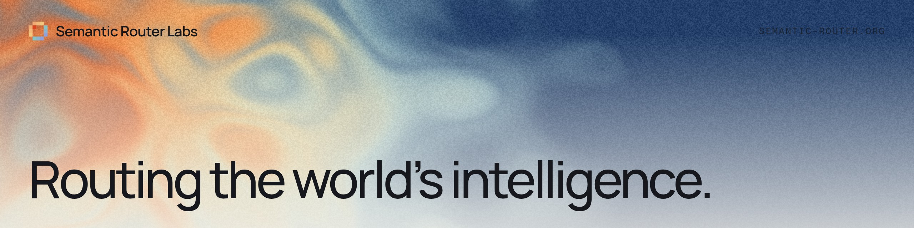

<picture>
  <source media="(prefers-color-scheme: dark)" srcset="https://raw.githubusercontent.com/semantic-router/.github/main/profile/github-banner-dark.jpg">
  
</picture>

**Routing the world’s intelligence.** Semantic Router Labs is an open research lab. For every request, we decide which
model should answer, what it may see and do, and when the work is done. We build that layer at every level, from the
agent harness down to the decision models, in the open and with the team behind
[vLLM Semantic Router](https://github.com/vllm-project/semantic-router).

[semantic-router.org](https://semantic-router.org) · [Mission](https://semantic-router.org/mission/) · [Research](https://semantic-router.org/research/) · [Join](https://semantic-router.org/join/) · [X](https://x.com/SemanticRouter) · [LinkedIn](https://www.linkedin.com/company/semantic-router-labs) · [Hugging Face](https://huggingface.co/vllm-sr)
